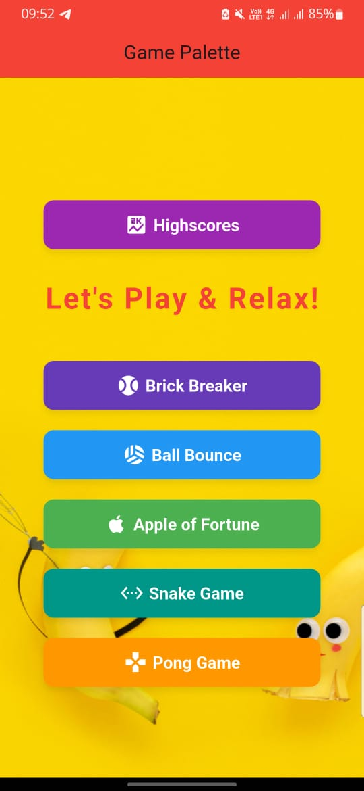
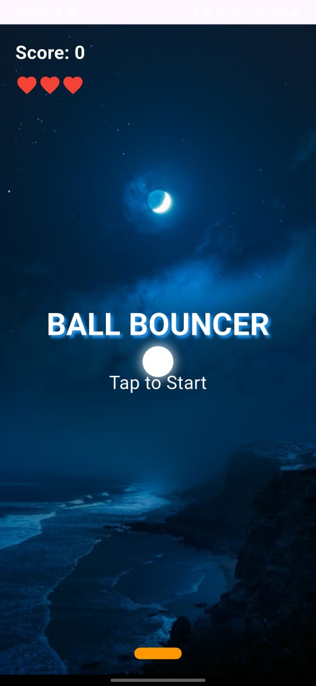
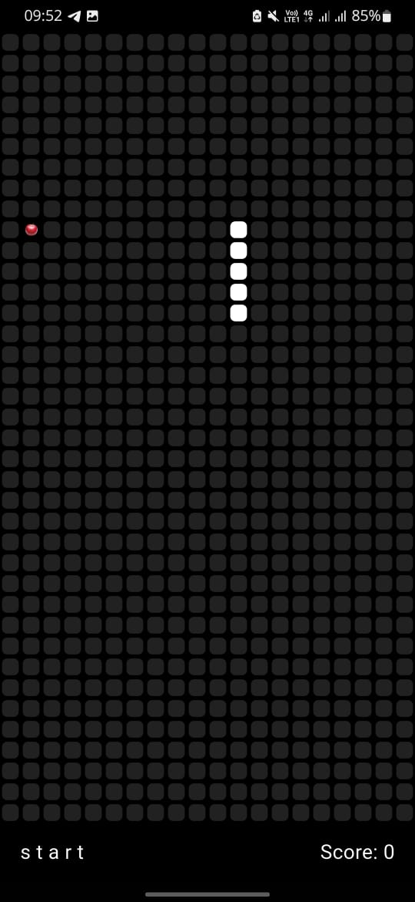
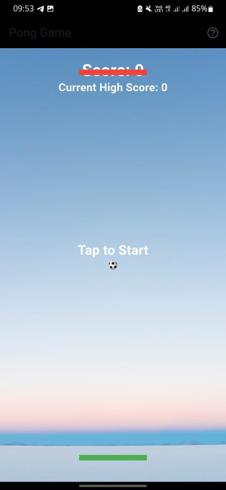
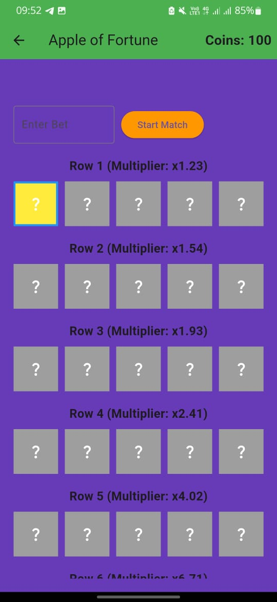
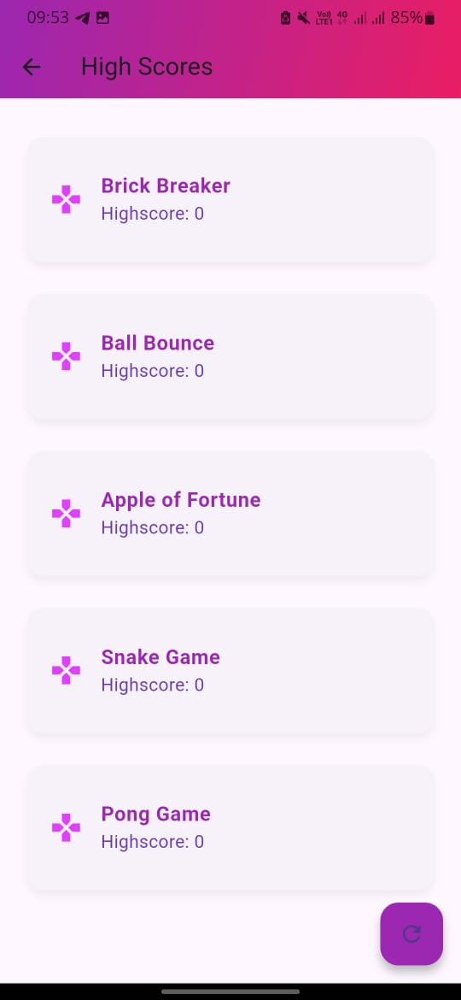
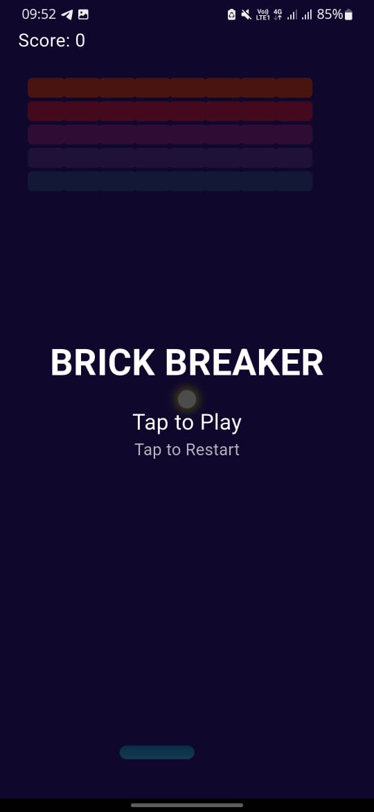

# 🎮 Arcadia

**A collection of fun mini-games for Android, with an offline high-score board.**

Arcadia is an Android application that brings multiple mini-games together in one place. Play for fun, challenge yourself, and track your high scores locally without needing an online leaderboard.

## 📱 Screenshots

Explore the application's interface and gameplay.

  
  
  

  
  

  
  

## ✨ Features

- **Multiple Mini-Games** — Enjoy a variety of games in one Android application.
- **Offline High Scores** — Track your scores without requiring an online leaderboard.
- **Single-Player Challenge** — Compete against your own previous performances.
- **Mobile Gaming** — Play on your Android device.

## 🎯 Project Goal

Arcadia was developed as an Android application project focused on bringing mini-games and local high-score tracking together in a simple gaming experience.

## 🚀 Getting Started

1. Clone or download this repository.
2. Open the project using a compatible Android development environment.
3. Configure the required SDKs and dependencies.
4. Build and run the application on a compatible Android device or emulator.
5. An apk file will be added to here in the future..
